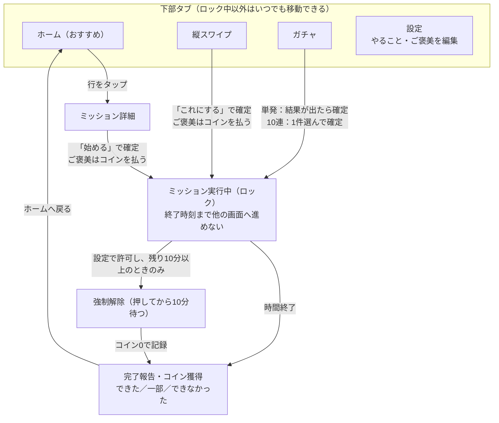
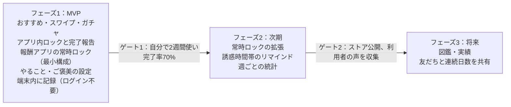

# 誘惑断ちアプリ「ドパガキデトックス」設計書

最終更新：2026-11-08（第2版。変更点は12章）

## 1. 概要と目的

ドパガキデトックスは、SNSやゲームを開いてしまう「手グセ」を、同じ手触りのまま健全な行動に置き換えるAndroid向けのスマホアプリです。ショート動画風のスワイプやガチャを回すと「読書15分」「筋トレ10分」「ゲーム20分」などのミッションがランダムに出て、確定したらその時間が終わるまで先に進めません。ご褒美に設定したゲームやSNSのアプリは普段ロックされ、ご褒美ミッションの間だけ開けます。

**解決したい課題**

- 暇な瞬間に無意識でSNS・ゲームを開き、気づくと1時間以上経っている
- 「やめよう」と意志だけで我慢すると続かない
- 読書・運動などやりたいことがあるのに、着手のきっかけがない

**目指す状態**

- 手持ち無沙汰の瞬間に、SNSではなくこのアプリを開く習慣ができる
- 1日の中で「やること」と「ご褒美（ゲーム等）」の時間が自然に配分される
- ご褒美も時間が決まっているので、罪悪感なく楽しめる

**成功指標（案）**

| 指標 | 目標の目安 |
| --- | --- |
| ミッション完了率 | 確定したミッションの70%以上を完了 |
| 1日の健全行動時間 | 読書・運動などの合計30分以上 |
| 継続日数 | 連続ログイン・完了7日以上 |
| 対象アプリの利用時間 | 端末の利用時間で導入前比 −30%（計測方法は9.5） |

## 2. コンセプトと設計方針

コンセプトは「誘惑の“型”はそのまま、“中身”だけ健全に入れ替える」です。SNSやゲームがやめられない仕組みをあえて再現し、その出口を読書・運動などのミッションにつなげます。

| 中毒性の仕組み | 元のアプリでの例 | ドパガキデトックスでの使い方 |
| --- | --- | --- |
| 無限スクロール | ショート動画、タイムライン | 縦スワイプでミッションカードが次々出る（1時間に3回までの更新制限つき） |
| 予測できない報酬 | ガチャ、ルートボックス | 何が出るか分からない抽選でミッションを決める |
| レア度・演出 | SSR、虹色演出 | ご褒美系をレア枠にして当たる喜びを残す |
| 通知・新着 | おすすめ、新着バッジ | 時間帯や気分に合わせたおすすめミッション |
| 収集・記録 | 図鑑、ログインボーナス | 完了履歴、連続日数、獲得コイン |

**設計方針**

1. **3タップ以内でミッション開始**：誘惑に負けそうな瞬間に考えさせない。
2. **確定したら戻れない**：ミッションが確定すると、その時間は他画面へ進めない（6章）。
3. **ミッションは時間だけで区切る**：「30回」などの回数で終わるミッションは作らない。早く終わっても時間までは実行画面のまま。
4. **ご褒美も時間で区切る**：ゲームやSNSもミッションとして出し、その時間だけ対象アプリを開ける。
5. **ご褒美はコインと交換**：やること1分で100コイン、ご褒美1分で300コインを基準にする（7.5）。
6. **我慢ではなく置き換え**：禁止ではなく、選ぶ楽しさを残す。
7. **自分で中身を決める**：やること・ご褒美・時間・出やすさは設定で変えられる。ただし自分に有利になる変更は10分待ってから反映する（5.6）。

**UIの方針**

- Material Design 3に沿い、トップアプリバー、ナビゲーションバー、ボトムシート、スイッチなどは標準部品を使う
- 白ベース。色はカテゴリとレア度の識別だけに使い、面の塗りや装飾は最小限にする
- グラデーション、発光、枠付きカードの多用など「作り込みすぎた見た目」は避ける
- ホームはXのタイムラインと同じ形にし、見慣れた操作感で開ける

## 3. 機能一覧

MVPは「ミッションを出す・確定する・やり切る・記録する」に、報酬アプリの常時ロック（最小構成）を加えた範囲とします。常時ロックがないと、ミッション中でも対象アプリを自由に開けてしまい、コインとご褒美の仕組みが働かないためです。

| ID | 機能 | 内容 | 優先度 |
| --- | --- | --- | --- |
| F01 | おすすめフィード | 時間帯・履歴に応じたミッションをXのタイムライン形式で表示（線区切り、ボタンなし） | MVP |
| F02 | 縦スワイプ | 全画面カードを上下スワイプで次々表示、「これにする」で確定 | MVP |
| F03 | ガチャ | コインで単発／10連を引き、レア度付きでミッションを抽選 | MVP |
| F04 | ミッション実行（ロック） | 確定後はタイマー画面に固定し、終了まで他画面へ進めない | MVP |
| F05 | 完了報告・記録 | 完了／一部／できなかったを記録、コイン付与、連続日数 | MVP |
| F06 | ミッション設定 | やること・ご褒美の追加／編集、時間、出やすさ、カテゴリ、レア度 | MVP |
| F07 | ロック設定 | 強制解除・一時停止の可否、静かな時間帯、有利な変更の10分待ち | MVP |
| F09 | 報酬アプリの常時ロック（最小構成） | 対象アプリが前面に来たらロック画面を重ね、ご褒美ミッション中だけ通す（6.2） | MVP |
| F08 | 統計 | 週ごとのカテゴリ別時間、完了率、対象アプリの利用時間 | 次期 |
| F09+ | 常時ロックの拡張 | 曜日・時間帯ごとのルール、アプリごとの上限など | 次期 |
| F10 | リマインド通知 | よく誘惑に負ける時間帯に「1回引こう」と通知 | 次期 |
| F11 | 図鑑・実績 | 完了したミッションのコレクション、称号 | 将来 |
| F12 | フレンド・共有 | 友だちと連続日数を見せ合う | 将来 |

## 4. 画面一覧と画面遷移

画面は下部タブの4画面（ホーム・縦スワイプ・ガチャ・設定）と、タブを持たない画面で構成します。

| ID | 画面 | 役割 | モックアップ |
| --- | --- | --- | --- |
| S01 | ホーム（おすすめ） | 起動時の画面。おすすめミッションをXのタイムライン形式で表示 | 01 |
| S01-2 | ミッション詳細 | ホームの行をタップすると開くボトムシート。ここで「始める」 | 02 |
| S02 | 縦スワイプ | 1画面1ミッションを上スワイプで次々表示 | 03 |
| S03 | ガチャ | コインで抽選してミッションを決める | 04 |
| S03-2 | ガチャ結果（10連） | 10件から1件を選んで確定 | 05 |
| S04 | 設定 | やること・ご褒美・ロックの強さを編集 | 08 |
| S05 | ミッション実行中 | カウントダウン。終了まで他画面へ進めない | 06 |
| S05-2 | 強制解除の待機 | 10分のカウントダウンと確認 | 07 |
| S06 | 完了報告 | 結果の報告とコイン獲得 | なし |
| S07 | アプリのロック画面 | 対象アプリの上に重ねて表示 | 09 |
| S08 | 初回設定 | ユーザー補助の開示と同意、通知の許可（9.2） | なし |



ホーム・スワイプ・ガチャのどこから確定しても同じ実行画面に入り、時間終了か強制解除でしか出られません。設定はロック中には開けません。

## 5. 各画面の詳細仕様

### 5.1 ホーム（おすすめ）

Xのタイムラインと同じ見た目で、おすすめミッションを1列に並べるだけの画面です。カードや枠は使わず、行と行の間を細い線で区切ります。アプリを開いたら最初にこの画面が出ます。

- **表示するもの**：タイムラインのみ。今日の記録やカテゴリ一覧は置かない
- **1行の構成**：左にカテゴリの丸アイコン、右の1行目に「ミッション名・カテゴリ・時間」、2行目以降に本文（ひとこと）、最下段に小さく「レア度・これまでの回数・最後に実施した日」。ご褒美の行は最下段に「必要コイン・今日あと何回」を出す
- **ボタン**：行にはボタンを一切置かない。行をタップするとミッション詳細（ボトムシート）が開き、そこで「始める」
- **上部**：アプリ名だけのトップアプリバー
- **並び順**：1回の更新で20件を出す。中身は7.3・7.4のルールで抽選し、「あとで」に保存したミッションを先頭に置く
- **プルで更新**：引っ張るとおすすめが入れ替わる。更新は1時間に3回まで（7.4）。上限に達したら、次に更新できるまでの時間をタイムラインの末尾に表示

**ミッション詳細（ボトムシート）**

- ミッション名、時間、レア度、ひとこと、これまでの回数
- やることは「完了で○○コイン」、ご褒美は「始めるのに○○コイン」と表示
- 置くボタンは「始める」の1つだけ
- ご褒美でコインが足りないとき、またはその日のホーム・スワイプ枠を使い切ったときは「始める」を押せず、理由（「あと○○コイン」「今日の枠は使い切りました」）を表示
- 「始める」を押すと実行画面へ移り、ロックがかかる。ご褒美はこの時点でコインを引く

### 5.2 縦スワイプ（ショート動画風）

TikTokやショートのように、1画面に1ミッションを全画面で表示し、上スワイプで次へ進みます。上部にタブは置かず、画面全体をミッションの表示に使います。

- **背景**：カテゴリ色を薄くした単色の背景と、大きなカテゴリアイコン
- **右側アクション**：「これにする」（確定）、「あとで」（保存）の2つ
- **下部**：ミッション名、時間、説明、累計実施回数。やることは獲得コイン、ご褒美は必要コインを表示
- **ご褒美の確定**：ホームと同じく、コインを払い、ホーム・スワイプ枠を1回使う
- **更新回数の上限**：1回の更新で20枚まで表示。最後まで見ると次の20枚を読み込み、これを1回の更新と数える。更新はホームと合わせて1時間に3回まで（7.4）

**あとで**：保存したミッションはホームのタイムラインの先頭に並びます。始めるときの扱い（ご褒美はコインと枠が必要）はホームと同じです。

### 5.3 ガチャ

ゲームのガチャ風にカプセルや召喚演出でミッションを抽選します。

- **単発**：600コイン。1件抽選し、結果カードから「スタート」。結果画面を閉じても自動で実行画面に移る（キャンセル不可）
- **10連**：4,500コイン。10件出た中から1件選んで確定。選ばなかった9件は消える（「あとで」には入らない）
- **ご褒美の費用**：ガチャで出たご褒美は、ガチャのコインだけで始められる（追加のコインは不要）
- **ガチャで出たやること**：通常どおり完了でコインがもらえる
- **レア度**：N（短いやること）／R（標準のやること）／SR（長めのやること or 短いご褒美）／SSR（長めのご褒美）
- **演出**：レア度に応じて光の色が変化（白→青→金→虹）
- **天井**：やることを5回連続で完了すると、次のガチャはご褒美確定（7.3）
- **ご褒美が出ないとき**：その日のご褒美上限に達している、静かな時間帯である、などでご褒美が出ない場合は、ガチャ画面に「今はご褒美が出ません」と表示してから引かせる

### 5.4 ミッション実行中（ロック画面）

確定したミッションのカウントダウン画面です。終了するまでアプリ内の他画面へは進めません（6章）。

- 円形プログレスと残り時間、終了時刻、ミッション名、ひとこと応援、獲得できるコイン
- ミッションは時間だけで区切る。早く終わっても時間までは実行画面のまま
- 一時停止は1回まで（最大5分）。5分たつと自動で再開する。強制解除の待機中は一時停止できない
- 「強制解除」は**残り10分以上のときだけ表示**する。残り10分を切るとボタン自体を消す
- 「強制解除」を押すと10分の待機に入り、その間「本当に解除しますか？」の確認を表示し続ける。待機中に「ミッションに戻る」を押せば取り消せる。10分たつと解除（6.3）
- 終了時に「できた／一部できた／できなかった」を報告し、コインを獲得
- 運動系では「つらいときは休んでOK。終わったら『一部できた』で報告」と表示する

### 5.5 設定

やること・ご褒美の中身と、ロックの強さを自分で決める画面です。

- **やることリスト**：名前、カテゴリ、時間（5〜120分）、出やすさ（1〜5）、レア度（N／R／SR）、有効／無効
- **ご褒美リスト**：名前、時間（5〜60分）、1日の上限回数、出やすさ、レア度（SR／SSR）、**対象アプリ**（端末にインストールされたアプリから選ぶ。例：ゲームA、SNS B）
- **レア度の初期値**：時間から自動で入れる（やること：5〜14分はN、15〜29分はR、30分以上はSR／ご褒美：15分以下はSR、16分以上はSSR）。あとから変えられる
- **ロック設定**：報酬アプリの常時ロック、強制解除の可否、一時停止の可否、静かな時間帯（深夜はご褒美を出さない）
- **目標**：1日の健全行動時間の目標、通知時間帯
- **データ**：バックアップ、リセット
- **出現率**：MVPでは設定画面に出さず固定する（7.1）

### 5.6 有利になる設定変更の10分待ち

自分に有利になる（ご褒美が増える・ロックが緩む）設定変更は、強制解除と同じく押してから10分たってから反映します。待機中は設定画面の上部に「反映待ち 9:42」と表示し、いつでも取り消せます。厳しくする方向の変更はすぐ反映します。

| 区分 | 10分待ちにする変更 | すぐ反映する変更（逆方向） |
| --- | --- | --- |
| 常時ロック | オフにする、対象アプリを外す | オンにする、対象アプリを足す |
| ご褒美 | 追加・有効化、時間を延ばす、出やすさを上げる、1日の上限を増やす、レア度を下げる（SSR→SR） | 削除・無効化、時間を縮める、出やすさを下げる、上限を減らす、レア度を上げる |
| やること | レア度を上げる（獲得コインが増える） | 追加、レア度を下げる |
| ホーム・スワイプのご褒美枠 | 1日の回数を増やす | 減らす |
| 静かな時間帯 | 短くする、オフにする | 長くする、オンにする |
| 強制解除・一時停止 | 許可にする | 許可しない |

- 待機の時間は信頼時刻（6.4）で数えるので、アプリを閉じても端末の時計を変えても縮まない
- 待機中に別の有利な変更を加えた場合は、それぞれ別に10分待つ
- ロック中は設定を開けないが、ロック前に始めた待機はロック中も進む

## 6. ミッション確定時のロック仕様

ミッションが確定した瞬間から終了時刻まで、アプリ内はミッション実行画面に固定され、ホーム・スワイプ・ガチャ・設定には進めません。残り時間は端末の時計ではなく信頼時刻（6.4）で数え、アプリを閉じても再起動しても続きから再開します。

### 6.1 ミッション実行中のロック

**確定のタイミング**

- 縦スワイプ・ホーム：「これにする／始める」をタップした時点（ご褒美はここでコインを引く）
- ガチャ単発：抽選結果が出た時点
- ガチャ10連：10件から1件を選んだ時点

**ロック中にできること・できないこと**

| 操作 | ロック中 | 備考 |
| --- | --- | --- |
| ホーム・スワイプ・ガチャ | 不可 | ナビゲーションバーを非表示。端末の「戻る」操作も止める |
| 設定 | 不可 | 実行中にルールを緩める抜け道を防ぐ |
| 一時停止 | 1回・最大5分 | 設定でオフ可 |
| 強制解除 | 押してから10分後 | 残り10分以上のときだけ表示。待機中は確認を表示し、取り消し可（6.3）。解除するとコインは0、連続記録は維持 |
| アプリを閉じる | 可 | 再度開くと実行画面から再開 |
| 報酬アプリ | 開けない | 常時ロック中（6.2）。ご褒美ミッション中だけ開ける |

**ご褒美ミッションの場合**

「ゲーム20分」などのご褒美が確定すると、ドパガキデトックスはタイマー画面になり、対象アプリがその時間だけ開けるようになります（6.2）。時間が来ると対象アプリは自動でロックに戻るので、だらだら延長はできません。

**終了後**

1. 完了報告（できた／一部／できなかった）
2. コイン付与とひとこと演出
3. ご褒美の後は、次の1回がやること系になるよう抽選を補正（7章）
4. ホームに戻る

### 6.2 報酬アプリの常時ロック（MVP・最小構成）

ご褒美リストで対象アプリに選んだアプリは、普段はずっとロックしておきます。ご褒美ミッションが確定したときだけ、そのミッションの時間だけ開けるようにし、終わったら自動でロックに戻します。

- ロック中に対象アプリを開くと、ドパガキデトックスのロック画面を上に重ねて表示する（「このアプリはロック中です」）
- ロック画面から選べるのは「ドパガキデトックスを開く」と「強制解除」の2つだけ
- ご褒美ミッション中は、残り時間を通知に表示し、終了1分前に知らせる
- 時間が来たら対象アプリの上にロック画面を出し、端末のホーム画面に戻す
- 次のアプリは対象に選べない：既定の電話アプリ、既定のSMSアプリ、既定のホームアプリ、端末の設定、システムUI、キーボード、ドパガキデトックス自体
- LINEなどの連絡アプリを対象に選ぶときは「ロック中は連絡を受け取れても開けません」と警告する
- 実装はユーザー補助サービスを使う（9.3）

**MVPに入れないもの**：曜日・時間帯ごとのルール、アプリごとの利用上限、利用時間のグラフ（次期）

### 6.3 強制解除（10分待機）

ミッション中のロックも報酬アプリの常時ロックも、外すときは「押してから10分待つ」方式で統一します。すぐには外れないので、衝動での解除を防げます。

1. 「強制解除」を押す（ミッション中は残り10分以上のときだけ表示）
2. 10分のカウントダウンが始まり、その間ずっと「本当に解除しますか？」の確認と残り時間を表示する
3. 待機中に「ミッションに戻る」（常時ロックでは「やめる」）を押せば取り消し。ロックは続く
4. 10分たつと解除する
    - ミッション中のロック：ミッションを中断扱いにし、コインは0
    - 報酬アプリの常時ロック：対象アプリを30分だけ開けるようにし、その後また常時ロックに戻す（30分は初期値案）

待機中にアプリを閉じたり端末を再起動したりしても、カウントダウンは続きます。残り時間は通知にも表示します。

### 6.4 端末の時計を変えられても時間を守る（信頼時刻）

端末の時計（壁時計）はユーザーが設定から自由に変えられるため、そのまま使うと時計を進めるだけでロックが終わってしまいます。そこで、時間に関わる判定はすべて「信頼時刻」で行います。

**信頼時刻の求め方**

信頼時刻は「基準となる時刻」と「その時点からの経過時間」の足し算で求めます。経過時間には、ユーザーが変えられない起動からの経過時間（`SystemClock.elapsedRealtime()`。スリープ中も進む）を使います。

```
信頼時刻 = 基準時刻 + (今の elapsedRealtime − 基準を取ったときの elapsedRealtime)
```

| 状況 | 基準時刻の取り方 |
| --- | --- |
| 初回起動 | ネットワーク時刻が取れればそれを使い、取れなければ端末の時計を使う |
| 同じ起動の間 | 基準は取り直さない。端末の時計を変えても信頼時刻は動かない |
| 端末を再起動した後（起動回数 `Settings.Global.BOOT_COUNT` が変わった） | ネットワーク時刻（`SystemClock.currentNetworkTimeClock()`、Android 13以降）が取れればそれを基準にする。取れなければ、最後に保存した信頼時刻を基準にする（電源が切れていた間は経過に数えない） |
| ネットワーク時刻が取れるようになった | 基準をネットワーク時刻に取り直す。ただし信頼時刻を過去に戻すことはしない |

- 信頼時刻と起動回数・elapsedRealtimeは、1分ごとと、ミッション開始・終了などの操作のたびに保存する
- 端末の時計の変更（`ACTION_TIME_CHANGED`）を受けても判定には使わず、画面上の「○時○分に終了」の表示だけ更新する
- Android 12以前でネットワーク時刻が取れない端末は、再起動中の時間を数えない扱いになる。ユーザーに不利な方向にずれるだけなので許容する

**信頼時刻を使う判定**

ミッションの残り時間、一時停止の5分、強制解除の10分、有利な設定変更の10分、常時ロック解除後の30分、ご褒美で対象アプリを開ける時間、更新回数（1時間に3回）、1日の切り替え（4時）、静かな時間帯。

**1日の切り替え**

1日は朝4時に切り替えます（ご褒美の1日上限、ホーム・スワイプ枠、連続日数、「その日最初の完了」に使う）。日付は信頼時刻から求め、後戻りはさせません。タイムゾーンの変更で切り替えが前後する場合も、1日の切り替えは24時間に1回までとします。

**防げない抜け道（受け入れるもの）**

アプリのアンインストール、データの消去、ユーザー補助サービスのオフは端末側で止められません。自分との約束のためのアプリなので、これらは防がずに次の対応だけ行います。

- ユーザー補助がオフになっていたら、アプリを開いたときにホームの上部で知らせ、オンに戻す導線を出す
- オフになっていた時間は記録に残す（統計で本人が見られるようにする）

## 7. 抽選ロジック

抽選は「レア度を先に決め、その中からミッションを重み付きで選ぶ」2段階方式にします。ご褒美はレア枠に置き、出現率・1日の上限・コインで出すぎを防ぎます。

### 7.1 レア度の出現率と倍率（初期値案）

| レア度 | 中身の目安 | ガチャでの出現率 | コインの倍率 | 演出色 |
| --- | --- | --- | --- | --- |
| N | 5〜14分のやること（ストレッチ、片付け） | 50% | 1倍 | 白 |
| R | 15〜29分のやること（読書、筋トレ） | 35% | 1.25倍 | 青 |
| SR | 30分以上のやること、または15分以下のご褒美 | 12% | 1.5倍 | 金 |
| SSR | 16分以上のご褒美（ゲーム、SNS） | 3% | 2倍 | 虹 |

倍率は、やることの獲得コインとご褒美の必要コインの両方にかけます（7.5）。

### 7.2 レア度内での重み

各ミッションの重みは、設定の「出やすさ」に補正をかけて求めます。

```
w_i = p_i × (1 + 0.1 × d_i) × c_i
```

- p：設定した出やすさ（1〜5）
- d：最後に実施してからの日数（上限7日）。久しぶりのミッションほど出やすい
- c：直前補正。直前と同じミッションは0.2、ご褒美直後のご褒美は0

### 7.3 補正ルール

- ご褒美は、ミッションごとの1日の上限回数（初期値2回）に達したらガチャの抽選対象から外す
- ご褒美の次の1回は、やること系のみから抽選
- 静かな時間帯（初期値23時〜6時）はご褒美を出さない
- **天井**：やることを5回連続で「できた」で完了したら、次のガチャ（単発・10連）はご褒美確定。10連では10件のうち少なくとも1件がご褒美になる
    - 数えるのは15分以上のやることだけ。ホーム・スワイプ・ガチャのどこから始めたものも数える
    - 「一部できた」「できなかった」「強制解除」でカウントは0に戻る。ご褒美ミッションは数えず、カウントも戻さない
    - 上限到達や静かな時間帯でご褒美を出せないときは天井を使わずに持ち越す
- **枠が空のとき**：抽選したレア度に出せるミッションがない場合は、候補のある最も近いレア度に移す（同じ近さなら下のレア度）。天井が確定しているときは、出せるご褒美のある枠から選ぶ
- **おすすめフィード（ホーム・スワイプ）**：重み付きで重複なく20件を抽出し、時間帯タグ（朝・昼・夜）が一致するものを優先して並べる

### 7.4 ホーム・スワイプでのご褒美と更新回数

ホームとスワイプにもご褒美は出ますが、出現率はガチャの10分の1にし、始めるにはコイン（7.5）とホーム・スワイプ枠が必要です。

```
ホーム・スワイプでのご褒美の出現率 = ガチャでのご褒美の出現率 ÷ 10
```

| 中身 | ガチャ | ホーム・スワイプ |
| --- | --- | --- |
| SSR（ご褒美） | 3% | 0.3% |
| SRのうちご褒美（初期値案） | 6% | 0.6% |
| ご褒美の合計 | 9% | 0.9% |
| やること | 91% | 99.1% |

- 減らした分はやること系に回す
- **ホーム・スワイプ枠**：ホーム・スワイプ・「あとで」から始めるご褒美は1日1回まで（初期値）。ガチャのご褒美の1日上限とは別に数える
- 更新はホームの「引っ張って更新」とスワイプの「次の20枚」を合わせて数え、**1時間に3回まで**
- 数え方は直近60分間の回数。上限に達したら、いちばん古い更新から60分たつまで更新できない
- 上限中は、ホームはタイムラインの末尾に、スワイプは20枚目の次に「次の更新まで 47:32」を表示する
- 1回の更新で出るのは20件

### 7.5 コイン

コインは「やること1分＝100コイン」「ご褒美1分＝300コイン」を基準にし、どちらにもレア度の倍率をかけます。ご褒美1分には、やること3分が必要という交換比です。

**増えるとき**

| 行動 | 獲得コイン |
| --- | --- |
| やることを「できた」で完了 | 100 × 分 × レア度の倍率 |
| やることを「一部できた」で終了 | 上の半分（1コイン未満は切り捨て） |
| 「できなかった」・強制解除・ご褒美ミッションの完了 | 0 |
| 連続日数ボーナス（その日最初の完了時） | 日数 × 100（上限1,000） |
| 初回起動ボーナス | 3,000 |

**減るとき**

| 行動 | 必要コイン |
| --- | --- |
| ガチャ単発 | 600 |
| ガチャ10連 | 4,500 |
| ホーム・スワイプ・「あとで」からご褒美を始める | 300 × 分 × レア度の倍率 |
| ガチャで出たご褒美を始める | 0（ガチャのコインのみ） |

**例**

| ミッション | 時間・レア度 | コイン |
| --- | --- | --- |
| 机の上を片付ける | 5分・N | +500 |
| 肩と首のストレッチ | 10分・N | +1,000 |
| 紙の本を読む | 20分・R | +2,500 |
| 英語の長文を読む | 40分・SR | +6,000 |
| SNSを見る（ホームから） | 10分・SR | −4,500 |
| 好きなゲーム（ホームから） | 20分・SSR | −12,000 |

**ガチャの価格の決め方**

ガチャの価格は、ガチャで出るご褒美の価値（300 × 分 × 倍率）の期待値に合わせ、少しだけ安くしています。プリセット（好きなゲーム20分・SSR、SNSを見る10分・SR）で計算すると次のとおりです。

| | ご褒美が出る確率 | ご褒美の価値の期待値 | 価格 |
| --- | --- | --- | --- |
| 単発 | 9% | 約630コイン | 600コイン |
| 10連（いちばん良いものを選ぶ場合） | 約61% | 約4,720コイン | 4,500コイン |

- ガチャで出たやることは通常どおり完了でコインがもらえるので、「ガチャを引く→やることをこなす→コインが戻る」の循環になる
- 天井（ご褒美確定）のときは価値の期待値が約7,000コインになり、5回連続完了へのボーナスとして働く
- ご褒美の時間や出現率の初期値を変えたら、この表で価格を見直す

ホームとスワイプからやることを始めるのはコイン不要なので、コインが尽きても行動は止まりません。

## 8. データ設計

MVPは端末内（ローカルDB）のみで完結し、ログインやサーバーは持ちません。

**Mission（やること・ご褒美のマスタ）**

| 項目 | 型 | 説明 |
| --- | --- | --- |
| id | string | UUID |
| title | string | 例：読書 |
| kind | enum | task（やること）／reward（ご褒美） |
| category | enum | reading, exercise, study, chores, mind, game, sns |
| durationMin | int | task は 5〜120、reward は 5〜60 |
| rarity | enum | task は N, R, SR／reward は SR, SSR |
| weight | int | 出やすさ 1〜5 |
| dailyLimit | int? | ご褒美のガチャでの1日上限（task は null） |
| linkedApps | string[] | ご褒美の対象アプリのパッケージ名（task は空） |
| timeTags | enum[] | morning, day, night |
| enabled | bool | 抽選対象にするか |
| lastDoneAt | instant? | 最終実施日時（信頼時刻） |

**Session（実行履歴）**

| 項目 | 型 | 説明 |
| --- | --- | --- |
| id | string | UUID |
| missionId | string | Mission.id |
| source | enum | home, swipe, later, gacha_single, gacha_ten |
| startedAt | instant | 確定時刻（信頼時刻） |
| durationMs | long | 所要時間 |
| pausedMs | long | 一時停止した時間 |
| endsAt | instant | 終了予定時刻（信頼時刻。一時停止で後ろにずらす） |
| result | enum | running, done, partial, failed, aborted |
| coinsEarned | int | 獲得コイン |
| coinsSpent | int | ご褒美を始めるのに使ったコイン（ガチャ経由は0） |
| dayKey | date | 4時区切りの日付 |

**LaterItem（あとで）**：missionId, savedAt

**Wallet（コイン・記録）**：coins, streakDays, lastActiveDay（4時区切り）, pityCount（天井カウント）, pityReady（ご褒美確定の持ち越し）, refreshTimes（直近60分の更新時刻、最大3件）, feedRewardUsedDay・feedRewardUsedCount（ホーム・スワイプ枠の使用）

**Settings（設定）**：rewardAppLock, allowForceUnlock, unlockWaitMin（10）, unlockGraceMin（30）, allowPause, quietStart, quietEnd, dailyGoalMin, homeRewardRatio（0.1）, feedRewardDailyLimit（1）, refreshLimit（3）, refreshWindowMin（60）, dayStartHour（4）

**定数（MVPでは設定画面に出さない）**：rarityRates（N 50／R 35／SR 12／SSR 3）, rarityMultiplier（N 1.0／R 1.25／SR 1.5／SSR 2.0）, taskCoinPerMin（100）, rewardCoinPerMin（300）, gachaSingleCost（600）, gachaTenCost（4,500）, pityThreshold（5）, pityMinDurationMin（15）

**PendingChange（10分待ちの変更）**：id, target（mission／appLock／settings）, payload（反映する変更の内容）, requestedAt, appliesAt, status（waiting, cancelled, done）。強制解除と有利な設定変更の両方をこの表で扱う

**ClockAnchor（信頼時刻の基準）**：bootCount, elapsedAtAnchor, trustedAtAnchor, source（network／device／carried）, lastSavedTrusted, lastSavedElapsed

アプリ起動時に `result = running` かつ `endsAt` が信頼時刻より未来の Session があれば、ロック画面から再開します。

## 9. 技術構成

Androidのみに対応し、Kotlin＋Jetpack Composeのネイティブアプリとして、Material Design 3（Material 3コンポーネント）で作ります。

### 9.1 構成

| 領域 | 採用技術 | 理由 |
| --- | --- | --- |
| UI | Jetpack Compose＋Material 3 | トップアプリバー、ナビゲーションバー、ボトムシート、スイッチを標準部品で作れる |
| 対象SDK | targetSdk 36（Android 16）、compileSdk 36 | Google Playは2026年8月31日以降、新規アプリと更新に対象API 36以上を求めている |
| 最低OS | minSdk 29（Android 10） | 利用者の大半をカバーできる。ネットワーク時刻はAndroid 13以降のみ使い、それ以前は6.4の方法で補う |
| ローカルDB | Room（SQLite） | オフライン完結、履歴の集計がしやすい |
| 設定値 | DataStore | ロック設定や目標を保存 |
| 演出 | Composeアニメーション、Lottie | ガチャ演出を軽く作れる |
| 常時ロック | ユーザー補助サービス（AccessibilityService） | 前面アプリの切り替えを検知し、ロック画面を重ねる（9.3） |
| タイマー表示 | 継続通知のカウントダウン表示 | アプリを閉じても残り時間を通知に出す（9.4） |
| 配布 | Google Play | — |

### 9.2 権限と申告（必須）

| 権限・宣言 | 用途 | 必要な対応 |
| --- | --- | --- |
| ユーザー補助サービス（`BIND_ACCESSIBILITY_SERVICE`） | 常時ロック | Play Consoleの申告フォーム、アプリ内の開示と同意（下記）、申告用の動画 |
| `POST_NOTIFICATIONS` | 残り時間、終了、解除待ちの通知 | Android 13以降は実行時に許可を求める。許可されなくてもロックは動く（通知が出ないだけ） |
| `RECEIVE_BOOT_COMPLETED` | 再起動後に通知と信頼時刻を復元 | — |
| `<queries>`（ランチャーに出るアプリ） | 対象アプリを選ぶ一覧 | `QUERY_ALL_PACKAGES` は使わず、`ACTION_MAIN`＋`CATEGORY_LAUNCHER` のインテントで一覧を取る |
| `SCHEDULE_EXACT_ALARM`（任意） | ミッション終了の通知を時刻ぴったりに出す | Android 14以降は初期状態で許可されない。許可がなければ通常のアラームで出し、数分遅れることがある（ロックの判定には影響しない） |
| `PACKAGE_USAGE_STATS`（任意） | 対象アプリの利用時間の計測（9.5） | 特別なアクセスとして設定画面で許可してもらう |

**ユーザー補助の開示と同意（Google Playのポリシー上必須）**

- 初回設定（S08）で、ユーザー補助を使う理由と、扱うデータ（前面にあるアプリのパッケージ名のみ。画面の内容は読まない、端末の外に送らない）を、独立した画面で説明する
- 「同意する」を押してもらってから、端末のユーザー補助設定へ案内する。開示は利用規約やプライバシーポリシーの中だけで済ませない
- 同意しなかった場合は、常時ロックなしで使えるようにし、あとから同じ開示を再表示できるようにする
- Play Consoleの申告では、アプリを開く→開示を表示→同意・不同意の両方→常時ロックが動く様子、を撮った動画を出す
- ユーザー補助の使い方を変えたら申告を出し直す

**データセーフティ**：データは端末外に送信しない、と申告する。

### 9.3 常時ロックの実装（必須事項）

- ユーザー補助サービスの設定は `isAccessibilityTool="false"`、`canRetrieveWindowContent="false"`（画面の内容は読まない）、受け取るイベントは `TYPE_WINDOW_STATE_CHANGED` のみ
- イベントのパッケージ名が対象アプリで、ご褒美ミッション中でも強制解除後の30分でもなければ、`TYPE_ACCESSIBILITY_OVERLAY` のウィンドウでロック画面を重ねる（重ね表示の権限 `SYSTEM_ALERT_WINDOW` は不要）
- キーボード（IME）やシステムUIのイベントは無視する。除外アプリ（6.2）は既定のアプリを `RoleManager` などで判定する
- ご褒美の時間切れは、対象アプリが前面にあり画面がついている間、1秒ごとに信頼時刻と比べて判定する。時間切れになったら `GLOBAL_ACTION_HOME` で端末のホームに戻し、ロック画面を出す
- 画面が消えている間は判定しない。画面がついたとき（`ACTION_SCREEN_ON`／`ACTION_USER_PRESENT`）に判定し直す
- ユーザー補助サービスは常駐するので、MVPではフォアグラウンドサービスを使わない。将来使う場合は、Android 14以降で種類（`specialUse` など）の宣言とPlay Consoleでの申告が必要になる

### 9.4 タイマーと画面の必須事項

- 残り時間は信頼時刻と `endsAt` の比較で求める。カウントダウン通知は `setUsesChronometer(true)`＋`setChronometerCountDown(true)` を使い、毎秒更新しない
- ロック中は端末の「戻る」操作を Compose の `BackHandler` で止める。targetSdk 36では予測型「戻る」が有効になり `onBackPressed()` は呼ばれないため、古い書き方は使わない
- targetSdk 35以降は全画面表示（edge-to-edge）が必須になるので、Scaffold で画面の端の余白（インセット）を処理する
- 自動バックアップでは、実行中の Session、PendingChange、ClockAnchor を復元対象から外す（`dataExtractionRules`）。別の端末に復元したときにロックが残らないようにする

### 9.5 成功指標の計測

Digital Wellbeing の数値はほかのアプリから読めないため、対象アプリの利用時間は `UsageStatsManager` で自分で集計します（`PACKAGE_USAGE_STATS` の許可が必要、任意）。導入前と比べるには、使い始めの1週間の値を基準にします。

## 10. 健全性への配慮とリスク

中毒性の仕組みを使う以上、このアプリ自体が新しい依存先にならないよう歯止めを設けます。

| リスク | 対策 |
| --- | --- |
| ドパガキデトックス自体を延々スワイプしてしまう | 更新は1時間に3回まで。1日のスワイプ枚数を統計で見せる（次期） |
| タダでご褒美が出るまで更新を繰り返す | ホーム・スワイプのご褒美は出現率がガチャの10分の1で、始めるにはコインと1日1回の枠が必要 |
| ガチャを回すこと自体が目的になる | 課金なし。コインはやることの完了でしか増えない |
| ご褒美が出るまで引き直す | 単発は即確定。10連でも選ぶのは1件のみで、残りは消える |
| 設定を変えてご褒美を増やす | 有利になる変更はすべて10分待ち（5.6） |
| 端末の時計を進めてロックを終わらせる | 判定はすべて信頼時刻で行う（6.4） |
| 衝動でロックを外してしまう | 強制解除は押してから10分待つ。待機中は確認を出し続ける |
| ロックが厳しすぎてやめてしまう | 強制解除と一時停止を用意。強さは自分で選べる |
| 常時ロックで必要な連絡ができない | 電話・SMS・ホームアプリ・端末の設定は対象に選べない。連絡アプリを選ぶときは警告する |
| 失敗が続いて自己嫌悪になる | 「一部できた」も記録として残す。失敗時もコイン0にするだけで減らさない |
| 運動ミッションでの無理 | ロックは画面だけで、体を動かし続けることは求めない。実行画面に「つらいときは休んでOK」と表示し、「一部できた」で報告できる。強度は自分で設定 |

ゲームやSNSの利用で日常生活に大きな支障が出ている場合は、アプリだけに頼らず、医療機関や相談窓口の利用も選択肢です。アプリ内のヘルプにその案内を置きます。ストアの説明や広告では「依存症を治す」などの治療効果はうたわず、習慣づくりの支援として説明します。

## 11. 開発スコープとロードマップ、未決事項

まず自分自身が2週間使えるMVPを作り、完了率が目標に届いたら常時ロックの拡張や統計に進みます。各フェーズの期間は未定です。



ゲートを越えたら次のフェーズに進み、越えなければ抽選ルールやロックの強さを調整します。

**未決事項**

- [ ] ガチャの出現率・価格、コインの初期値の最終決定（7.5の初期値案をMVPで試して調整）
- [ ] 常時ロックを強制解除したときに開けておく時間（初期値案は30分）
- [ ] 天井の回数（5回）と、数える最短時間（15分）
- [ ] 初期に入れておくやること・ご褒美のプリセット
- [x] 報酬アプリの常時ロックをMVPに入れるか → 最小構成で入れる
- [x] 対象とするAndroidのバージョン → minSdk 29、targetSdk 36

## 12. 変更履歴

**第2版（2026-11-08）**

- 報酬アプリの常時ロックを最小構成でMVPに追加（3章、6.2、9.3）
- ホーム・スワイプからのご褒美にコインを必要とし、1日1回のホーム・スワイプ枠を新設（5.1、5.2、7.4）
- 更新回数を「10分ごとに3回」から「1時間に3回」に変更（7.4）
- 有利になる設定変更をすべて10分待ちに（5.6）
- 端末の時計の変更への対策として信頼時刻を追加（6.4、8章）
- 天井を「SR以上確定」から「ご褒美確定」に変更し、数え方を定義（7.3）
- コインを「やること1分＝100、ご褒美1分＝300」に変更し、レア度の倍率（N 1倍、R 1.25倍、SR 1.5倍、SSR 2倍）を追加。ガチャの価格を単発600、10連4,500に変更（7.5）
- ガチャの3連を10連に変更。選ばなかった分は「あとで」に入れず消す（5.3）
- ミッションを時間だけで区切るものに統一（2章、5.4）
- 残り10分未満では強制解除のボタンを出さない（5.4、6.1、6.3）
- おすすめフィードを「上位20件」から「重み付きで20件を抽出」に変更（7.3）
- 「出にくくする」を削除（5.1、5.2）
- 1日の切り替えを朝4時に（6.4）
- 抽選する枠が空のときの扱いを追加（7.3）
- 技術の必須事項（対象SDK、権限と申告、常時ロックの実装、タイマー、戻る操作、バックアップ）を追加（9章）
